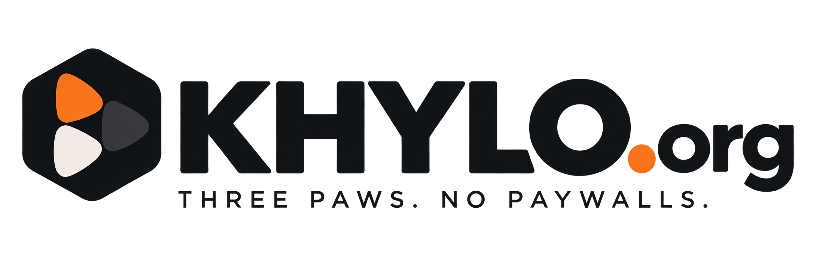

<p align="center">
  
</p>

<h1 align="center">Khylo Server</h1>

<p align="center">
  Your movies, shows, music, audiobooks, books and live TV, streamed from your own hardware to every screen in your home.<br>
  Free, open source and self-hosted. No subscriptions, no cloud account, no tracking.
</p>

---

<!-- khylo-downloads:main -->
<p align="center">
<a href="https://github.com/khylo-org/khylo/releases/download/DEV-V26.11.02.02/khylo-server-26.11.02.02-windows-x64-setup.exe"></a>
<a href="https://github.com/khylo-org/khylo/releases/download/DEV-V26.11.02.02/khylo-server-26.11.02.02-macos-arm64.tar.gz"></a>
<a href="https://github.com/khylo-org/khylo/releases/download/DEV-V26.11.02.02/khylo-server-26.11.02.02-macos-x64.tar.gz"></a>
<a href="https://github.com/khylo-org/khylo/releases/download/DEV-V26.11.02.02/khylo-server_26.11.02.02_amd64.deb"></a>
</p>

<p align="center"><sub><a href="https://github.com/khylo-org/khylo/releases/latest">Proxmox, Docker, Arm and every other file</a></sub></p>
<!-- /khylo-downloads -->

<p align="center"><sub><b>Looking to install Khylo?</b> This page is the source code. Use the buttons above, or see the <a href="https://github.com/khylo-org/khylo">install guides</a>.</sub></p>


Khylo Server is the heart of Khylo. It organizes your media library, fetches artwork and details, and streams to the Khylo apps on your TV, phone and browser. Everything stays on your own computer or server.

## Highlights

- **Khylo TV.** Always-on, 24/7 TV channels built automatically from your own library, with a real program guide. Tune in mid-show like real TV.
- **Live TV.** Bring your own IPTV subscription (M3U) or HDHomeRun tuner. Khylo's smart IPTV setup sorts the provider's list for you: live channels by group, with on-demand movies, series and adult content set aside, so your guide stays usable.
- **Automatic Skip Intro and Skip Credits.** Khylo listens for each show's theme music across a season and recognizes end credits by how they sound and look. No chapter markers needed.
- **Home profiles.** Everyone in your home gets their own profile, watch history and optional PIN, and switches without signing in again. People you share your server with can add profiles for their own household; a profile never gets more access than the person who made it.
- **Kids profiles.** Limit a profile to the ratings and libraries you choose. Only an admin can change those limits.
- **Easy sign-in.** Add a TV or phone with a 6-character code or a QR code. No typing passwords on a remote.
- **Plays almost anything.** Direct play when the device supports the file, with automatic conversion when it doesn't.
- **Music, audiobooks and books,** each with its own experience in the Khylo apps.

## Install Khylo Server

Khylo Server runs on Windows, Mac, Linux, Proxmox and in Docker. Downloads and step-by-step guides are in the
[Khylo project](https://github.com/khylo-org/khylo/tree/main/Install): install, first-time setup, network drives,
away from home, hardware transcoding, backups and troubleshooting.

## Building from source

**You need:** the [.NET 10 SDK](https://dotnet.microsoft.com/download) and an FFmpeg build with hardware acceleration.

```bash
dotnet build Khylo.sln -c Release
dotnet test Khylo.sln -c Release --no-build
dotnet Khylo.Server/bin/Release/net10.0/khylo.dll --webdir /path/to/web/dist --ffmpeg /path/to/ffmpeg   --datadir ./data --configdir ./config --cachedir ./cache --logdir ./log
```

The server listens on port **8096**. Open `http://localhost:8096` to finish setup: create your admin account and add your
libraries. The web app comes from [Khylo-Web](https://github.com/khylo-org/khylo-web); build it and pass its `dist` folder
as `--webdir`, or use the packaged downloads, which include it.

Keep `data`, `config`, `cache` and `log` out of version control. They hold your library database, users and any IPTV logins.

### Reaching it from outside your home

The apps connect over plain HTTP on your home network. For access from outside, put the server behind HTTPS with a certificate
from a recognized authority (for example a reverse proxy with Let's Encrypt). Phones and Apple devices refuse self-signed
certificates. See [away from home](https://github.com/khylo-org/khylo/blob/main/Install/remote-access.md).

## Contributing and security

Please read [CONTRIBUTING.md](CONTRIBUTING.md) and [SECURITY.md](SECURITY.md).

## License

Khylo is free software under the [GNU General Public License v2](LICENSE). It is built on open-source components, including the Jellyfin project, whose copyright notices are kept as the license requires. See [NOTICE.md](NOTICE.md).
