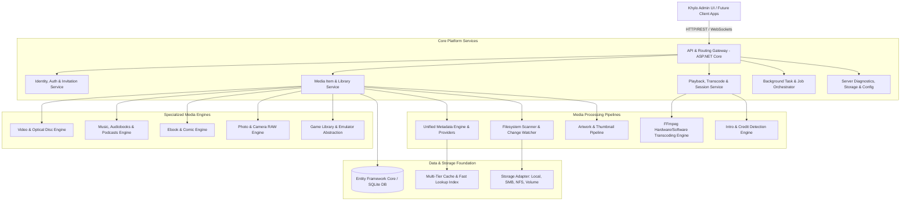

# Khylo Server — High-Level Architecture & System Design

**Document Version:** 1.0.0  
**Date:** September 2026  
**Status:** Architectural Blueprint  
**Target Platform:** Cross-Platform .NET 10 (Linux, Windows, macOS, Docker)

---

## 1. Architectural Philosophy

Khylo is designed as an **omni-media, self-hosted, API-first media server**. Unlike previous generations of media servers that treat movies and television series as the fundamental abstraction and awkwardly bolt on audio and images as secondary concepts, Khylo decouples the media engine into a **pluggable capability-based domain**.

Every media asset in Khylo is an instance of a **MediaItem** characterized by:
- **Stable Identity:** Uniquely identifiable across filesystem moves, renames, and metadata refreshes.
- **Physical Representation:** Single file, multi-file set, disc structure, or virtual archive.
- **Semantic Classification:** Media Type, Container, Codec, Structural hierarchy (e.g., Series -> Season -> Episode; Author -> Series -> Book; Platform -> Game).
- **Capability Flags:** Direct playable, transcodeable, readable, browseable, emulatable, executable, taggable.
- **Independent User States:** Playback progress, reading position, bookmarking, playlist state, ratings, favorites.

---

## 2. High-Level Subsystem Topology

---

## 3. Subsystem Breakdown

### 3.1. API & Routing Gateway
- Built on ASP.NET Core Kestrel with minimal latency routing and response compression.
- Exposes standardized REST endpoints documented via OpenAPI 3.0 / Swagger.
- Supports real-time WebSocket communication for session synchronization, playback commands, task progress, and live administrative events.

### 3.2. Pluggable Media Engines
Each supported media domain possesses a dedicated engine implementing `IMediaTypeHandler`:
- **Video Engine:** Handles multi-codec video streams, DVD/Blu-ray structures (`.iso`, `VIDEO_TS`, `BDMV`), chapter markers, and embedded audio/subtitles.
- **Audio Engine:** Distinct handling for Music (Artist/Album/Track), Audiobooks (Author/Series/Book/Chapter with persistent listening position), and Podcasts (RSS syndication, downloads).
- **Reading Engine:** Native parsers for Ebooks (EPUB, PDF, MOBI, AZW) and Comic Book Archives (CBZ, CBR, CBT) with page-level reading progress.
- **Photo Engine:** High-performance thumbnailing, EXIF/IPTC/XMP extraction, and non-destructive RAW preview rendering (CR2, CR3, NEF, ARW, DNG).
- **Game Engine:** ROM and disc image classification (NES through Dreamcast, MS-DOS), emulator core association, and save-state cataloging.

### 3.3. Transcoding & Acceleration Subsystem
- Dynamic hardware acceleration auto-detection: NVIDIA NVENC/NVDEC, Intel QuickSync (QSV), AMD AMF, Linux VAAPI, and Apple VideoToolbox.
- Transparent fallback: Gracefully falls back to high-efficiency software transcoding if hardware limits or driver failures occur.
- Diagnostics: Real-time telemetry exposed to the administrator dashboard detailing encoder parameters, speed factor, dropped frames, and hardware utilization.

### 3.4. Background Processing & Task Orchestrator
- Multi-queue job system with priority ranking (Interactive, High, Normal, Maintenance).
- Concurrency limiting to prevent background indexing from starving real-time transcoding sessions.
- Resumable, cancellable tasks with percentage progress and detailed error logs.

---

## 4. Boundary Protection & Client Independence

Per **Master Scope Rule 1 & Rule 10**:
- The server codebase strictly encapsulates the backend domain, business logic, storage engines, and API contracts.
- The ONLY web UI hosted directly by the server is the **Khylo Server Administration Console** and the **Server Setup App**.
- Consumer-facing clients (mobile apps, smart TV apps, desktop players, ebook/comic readers) interact exclusively through documented public APIs.
