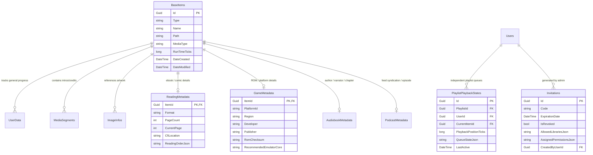

# Khylo Server — Database Architecture & Schema Evolution

**Document Version:** 1.0.0  
**Date:** September 2026  
**Status:** Architecture & Migration Specification  
**ORM Engine:** Entity Framework Core (Provider: `Microsoft.EntityFrameworkCore.Sqlite`)

---

## 1. Baseline Schema Analysis

The media server persistence layer currently operates through `KhyloDbContext` using an embedded SQLite database (`khylo.db`). The core entity model centers around a heavily overloaded single-table inheritance pattern:

### 1.1. `BaseItems` Table
Stores all folders, collections, movies, series, seasons, episodes, songs, albums, and photos in one flat table with over 60 columns. Video-specific flags (`IsMovie`, `IsSeries`, `InheritedParentalRatingValue`) exist alongside audio and image attributes.

### 1.2. `UserData` Table
Tracks user engagement per item:
```csharp
public class UserData
{
    public Guid ItemId { get; set; }
    public Guid UserId { get; set; }
    public long PlaybackPositionTicks { get; set; }
    public int PlayCount { get; set; }
    public bool Played { get; set; }
    public bool IsFavorite { get; set; }
    public double? Rating { get; set; }
    public DateTime? LastPlayedDate { get; set; }
}
```
**Architectural Problem:** Lacks a dedicated `PlaylistPlaybackState` table. When an item is played inside a playlist, mutating `UserData` directly corrupts the user's independent "Continue Watching" state for normal TV viewing.

### 1.3. `MediaSegments` Table
Stores temporal markers for video intros, outros, recaps, previews, and commercials:
```csharp
public class MediaSegment
{
    public Guid Id { get; set; }
    public Guid ItemId { get; set; }
    public MediaSegmentType Type { get; set; } // Commercial=1, Preview=2, Recap=3, Outro=4, Intro=5
    public long StartTicks { get; set; }
    public long EndTicks { get; set; }
    public required string SegmentProviderId { get; set; }
}
```

---

## 2. Khylo Schema Expansion (Phase 1 & 12)

To accommodate omni-media without bloating `BaseItems`, Khylo introduces modular auxiliary tables linked via 1-to-1 or 1-to-many foreign keys on `ItemId`:



---

## 3. Safe Migration Strategy

1. **Idempotent Migrations:** Every schema migration must check column/table existence before issuing `ALTER TABLE` or `CREATE TABLE` to prevent failures when re-running migrations.
2. **Non-Destructive Evolution:** Upstream columns and tables are never dropped without a multi-minor-version deprecation window. Legacy queries continue functioning while new Khylo services leverage the expanded tables.
3. **Automated Pre-Migration Backups:** Before applying EF Core migrations during startup, the `BackupService` creates a point-in-time snapshot of the database file.
