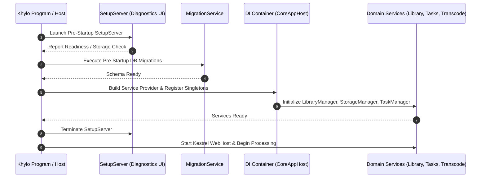

# Khylo Server — Subsystem Services & Lifecycle Specification

**Document Version:** 1.0.0  
**Date:** September 2026  
**Status:** Technical Specification  
**Framework:** Microsoft.Extensions.DependencyInjection (ASP.NET Core)

---

## 1. Overview

Khylo Server is structured as a collection of decoupled, lifecycle-managed singleton and scoped services registered via the ASP.NET Core dependency injection container. This document details each major service interface, its operational responsibilities, lifecycle scope, and dependencies.

---

## 2. Core Service Directory

### 2.1. Library & Scanner Subsystem
- **`ILibraryManager` (Singleton):** Central registry of root folders, collection folders, and virtual views. Resolves filesystem paths into domain entities (`BaseItem`), manages parent-child relationships, and coordinates item updates across the database.
- **`ILibraryMonitor` (Singleton):** Filesystem watcher service listening for OS file change notifications (`Created`, `Changed`, `Deleted`, `Renamed`). Buffers changes to prevent thrashing during active downloads and queues partial scans.
- **`IPartialScanCoordinator` (Singleton - Khylo Novel):** Performs targeted incremental scans of specific subtrees (e.g., a single modified album or season) instead of scanning entire libraries.

### 2.2. Metadata & Artwork Services
- **`IProviderManager` (Singleton):** Orchestrates metadata fetchers, image providers, and local NFO/XML parsers. Enforces priority order, rate-limiting, and local caching.
- **`IImageProcessor` (Singleton):** Powered by SkiaSharp. Responsible for high-performance image downscaling, aspect ratio calculations, poster blurhashes, and format conversion (WebP/JPEG/PNG).
- **`IRawPhotoProcessor` (Singleton - Khylo Novel):** Dedicated pipeline for extracting embedded JPEG previews from camera RAW files (Canon CR2/CR3, Nikon NEF, Sony ARW, Adobe DNG) without decoding full-resolution sensor bitmaps into RAM.

### 2.3. Transcoding, Streaming & Media Analysis
- **`IMediaEncoder` (Singleton):** Interacts with FFmpeg CLI and native libraries. Manages format probes (`ffprobe`), subtitle stream extractions, and hardware acceleration detection (NVIDIA, Intel QSV, AMD AMF, VAAPI, VideoToolbox).
- **`ITranscodeManager` (Singleton):** Allocates, tracks, throttles, and terminates live transcode processes. Maintains resource limits to avoid CPU/GPU starvation.
- **`IMediaSegmentManager` (Singleton):** Analyzes video audio tracks and visual streams to detect opening intros, closing credits, commercials, and recap segments. Persists segment markers with start/end ticks in `MediaSegments`.

### 2.4. Session & Playback State Management
- **`ISessionManager` (Singleton):** Maintains an active registry of all connected clients, device IDs, active streams, and playback positions. Broadcasts real-time events over WebSockets.
- **`IUserDataManager` (Singleton):** Manages user playback state (resume position, play count, last played date).
- **`IPlaylistStateManager` (Singleton - Khylo Novel):** Enforces strict separation between standalone item watch states and playlist progression states. Ensures watching an episode within a curated playlist does not pollute the primary "Continue Watching" dashboard queue.

### 2.5. Identity, Access & Invitations
- **`IUserManager` (Singleton):** Database-backed user management providing authentication, permission enforcement, and parental rating constraints.
- **`IInvitationManager` (Singleton - Khylo Novel):** Manages server invitation tokens with expiration lifespans, allowed library assignments, and auto-provisioning workflows.
- **`IDeviceManager` (Singleton):** Tracks client devices, capability profiles, and last-seen IP addresses. Allows administrators to remotely revoke device access.

### 2.6. Background Task Orchestration
- **`ITaskManager` (Singleton):** Manages recurring scheduled tasks (database optimization, library scans, chapter extraction, backup creation) and on-demand user-initiated jobs. Exposes cancellation tokens and live progress percentages.

### 2.7. Storage & Disaster Recovery
- **`IStorageManager` (Singleton - Khylo Novel):** Monitors volume health, mount availability, and storage capacities across local drives, SMB shares, and NFS mounts.
- **`IBackupService` (Singleton):** Handles automated and manual backups of configuration files, user profiles, permissions, and database schemas. Provides verified restoration routines.

---

## 3. Service Lifecycle & Startup Sequence

